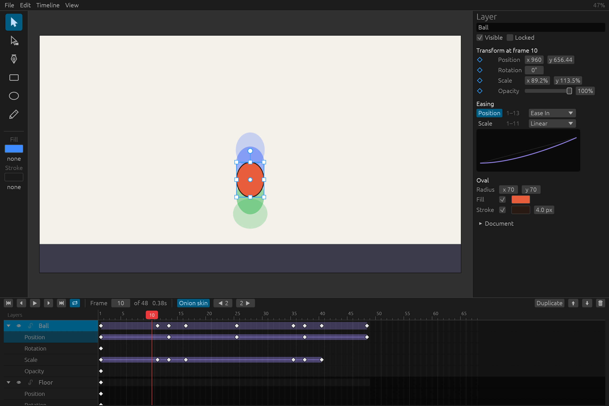

# Inkframe

An open-source 2D vector animation editor, in the spirit of Adobe Animate.
Written in Rust. Runs natively on Apple Silicon Macs, with Windows support
planned (the code is already cross-platform and CI builds it on Windows).



## What it does today

- **Draw** rectangles, ovals, Bézier paths with the Pen tool, and freehand
  pencil strokes on a stage of any size.
- **Animate with keyframes.** Go to a frame, move or change a layer, and a
  keyframe is created for you. Scale and rotate with on-stage handles, or
  type exact values in the properties panel. Inkframe tweens position,
  rotation, scale and opacity between keyframes.
- **Ease** each tween with Linear, Ease In/Out/In-Out, Hold, or a custom
  cubic-Bézier curve, previewed live in the properties panel.
- **Timeline** with layers, visibility and lock toggles, draggable keyframes,
  scrubbing, looped playback and onion skinning.
- **Export** with or without transparency:

  | Format | Alpha | Use it for |
  |---|---|---|
  | PNG sequence | ✔ | Lossless frames for any tool |
  | Apple ProRes 4444 / 4444 XQ | ✔ | Masters for editing and compositing |
  | Apple ProRes 422 HQ | — | High quality, smaller files |
  | H.264 MP4 | — | Review copies and the web |
  | HEVC with alpha (macOS) | ✔ | Small files with alpha for Apple devices and Safari |

- **Undo/redo** for every change, and plain-JSON project files (`.inkf`) that
  diff cleanly in version control.

## Getting started

You need [Rust](https://rustup.rs) (1.85 or newer) and, for video export,
[ffmpeg](https://ffmpeg.org):

```sh
brew install ffmpeg            # macOS; PNG sequences work without it
git clone <this repository> inkframe && cd inkframe
cargo run --release -- examples/bouncing-ball.inkf
```

If ffmpeg is somewhere unusual, point Inkframe at it with the
`INKFRAME_FFMPEG` environment variable.

## Using the editor

| Action | How |
|---|---|
| Select / move | Selection tool (`V`), click or drag a shape. Hold Shift to lock to one axis |
| Scale | Drag a square handle. Shift keeps proportions, Option/Alt scales from the pivot |
| Rotate | Drag the round knob, or just outside a corner. Shift snaps to 15° |
| Draw | Rectangle (`R`), Oval (`O`), Pencil (`Y`). Hold Shift for squares and circles |
| Pen (`P`) | Click for corners, drag for curves. Click the first point to close the shape; Enter, Esc or clicking the last point ends an open line. Backspace removes the last point, Shift snaps to 45° |
| Animate | Move the playhead to a later frame, then drag the shape or edit its transform |
| Insert / remove keyframe | `F6` / `Shift+F6`, or right-click the timeline |
| Play / pause | `Enter` |
| Step frames | `,` and `.` (or ← →), `Home` / `End` |
| Pan / zoom | Scroll or Space-drag to pan, pinch or ⌘-scroll to zoom, `⌘0` to fit |
| Export | `⌘E` |

Shortcuts follow Adobe Animate where possible. On Windows, use Ctrl in
place of ⌘.

## Project layout

```
crates/
  inkframe-core/    document model, keyframes, easing, undo (no UI)
  inkframe-render/  draws documents to pixels (tiny-skia)
  inkframe-export/  PNG sequences and ffmpeg video encoding
  inkframe-app/     the desktop editor (egui)
```

[ARCHITECTURE.md](ARCHITECTURE.md) explains how the pieces fit together and
where to start reading. [CONTRIBUTING.md](CONTRIBUTING.md) covers the
development workflow.

## Roadmap

Roughly in priority order:

- Subselection tool for editing anchors and handles of existing paths
- Per-property keyframes (ease position and opacity differently)
- Symbols: reusable, nested animations
- Layer start/end frames, so content can appear and disappear
- Audio tracks for lip-sync and timing
- GPU stage preview for very large scenes
- Windows installer and signed macOS app bundle

## License

Dual-licensed under either of

- [Apache License, Version 2.0](LICENSE-APACHE)
- [MIT license](LICENSE-MIT)

at your option. This is the standard licensing for Rust projects. Unless
you state otherwise, any contribution you submit is dual-licensed the same way.
