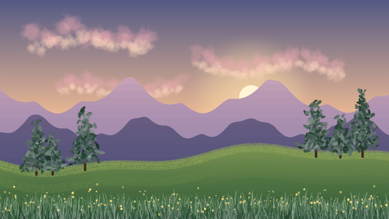

# Getting started with Inkframe

A one-page start: install Inkframe, find your way around, and make a ball
bounce in five minutes. For everything else, from drawing and painting to
rigging, lip sync and export, read **Inkframe for Artists**, the
beginner's guidebook, which comes as a PDF with every
[release](https://github.com/WhateverTrevor/inkframe/releases/latest)
(Help › Inkframe for Artists in the app opens it).

Shortcuts are written for macOS. On Windows, use **Ctrl** for **⌘** and
**Alt** for **⌥**.

## 1. Install and open it

Download the installer for your computer from the
[releases page](https://github.com/WhateverTrevor/inkframe/releases) and
install it. The release notes explain the one-time warning macOS and
Windows show for apps that aren't signed yet.

The first time Inkframe opens, a short tour points out each part of the
window. Take it: it's under a minute, and Help › Take the Tour shows it
again.

## 2. Make a ball bounce

1. Press **O** for the Oval tool and, holding **Shift**, drag near the top
   of the stage for a circle.
2. Press **V** for the Selection tool, click frame **12** in the
   timeline's ruler, and drag the ball down to the bottom of the stage. A
   keyframe appears, and frames 1 to 12 show it falling.
3. Click frame **24** and drag it back up to where it started.
4. Press **Enter** to play it.
5. For weight, click a frame between 1 and 12 and set **Position** to
   **Ease In** under Easing in Properties; between 12 and 24, **Ease Out**.

That's an animation. Press **⌘S** to save it and **⌘E** to export it as a
video.

## 3. Find anything

Can't find a command? Press **⌘K** (**Find a command** in the menu bar)
and type what it's for: "bulge", "rig", "web page", "lip sync". It shows
which menu the command is in and its keys. Hovering over a tool says what
it does, and the bar above the stage offers what can be done with what's
selected.

## 4. Explore the examples

**File › Open Example…** has finished projects to take apart: a bouncing
ball, a rigged character with lip sync, a flower inked and painted
Harmony-style, a sunset painted with the brushes, a multiplane camera
scene, and a campfire of particles.
Each opens as a new project, so change it freely.

| | |
|---|---|
|  | **rig.inkf**: a character built from parented parts, with lip sync on the mouth |
|  | **multiplane.inkf**: scenery at different depths, the camera dollying in |
|  | **particles.inkf**: fire, smoke and sparks under falling snow |
|  | **ink-and-paint.inkf**: line art coloured with the paint bucket from palette swatches |
|  | **painted-landscape.inkf**: a sunset painted with the ready-made brushes, a paint layer for each part |

## Where next

- **Inkframe for Artists**, the guidebook, attached to each
  [release](https://github.com/WhateverTrevor/inkframe/releases/latest):
  a chapter for each group of tools, projects (a walk cycle, a talking
  head, a web banner) and scripting. Build it yourself with
  `cargo xtask guide` (see [docs/guide](guide/README.md)).
- The [README](../README.md) lists everything Inkframe can do.
- Problems and ideas are welcome in the
  [issues](https://github.com/WhateverTrevor/inkframe/issues).
