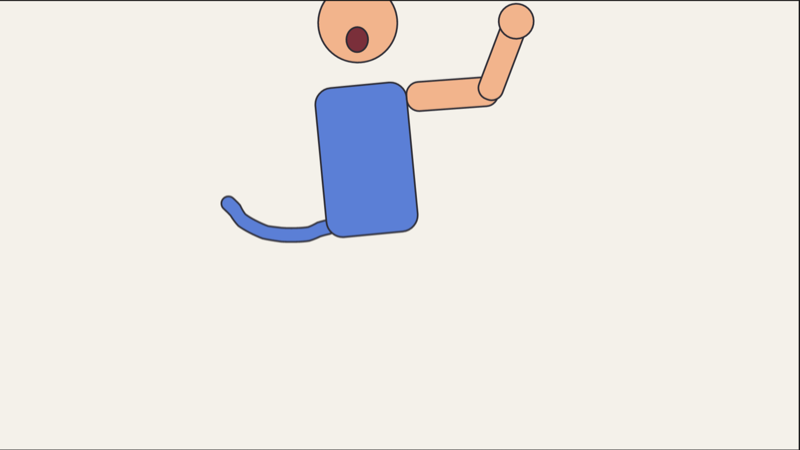
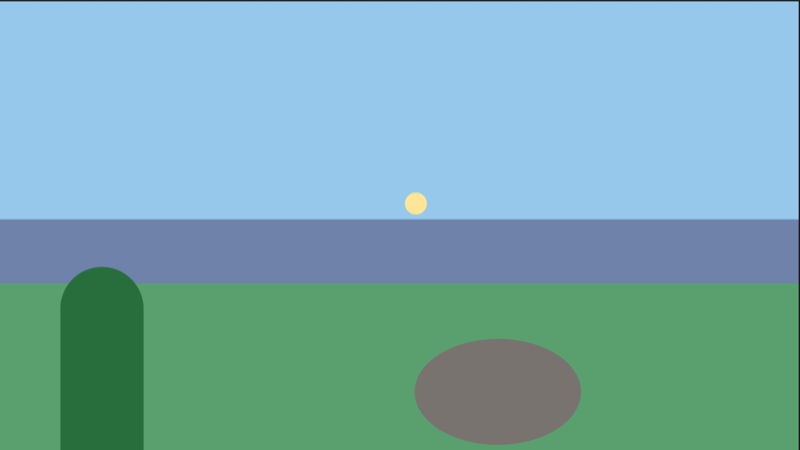
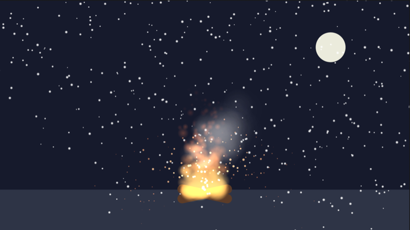

# Getting started with Inkframe

This guide takes you from a blank stage to a finished, exported animation
of a bouncing ball, in about fifteen minutes. Along the way you'll meet
the tools, keyframes, easing, the camera and export. If you've used Adobe
Animate or Toon Boom Harmony, most of it will feel familiar.

Shortcuts are written for macOS. On Windows, use **Ctrl** where you see
**Cmd**.

## 1. Install and open Inkframe

Download the installer for your computer from the
[releases page](https://github.com/WhateverTrevor/inkframe/releases) and
install it. The release notes explain the one-time warning macOS and
Windows show for apps that aren't signed yet.

Open Inkframe. You get an empty 1920×1080 stage, two seconds long at
24 frames a second.

## 2. Find your way around

The window is split into **areas**:

- **Tools**, on the left: drawing tools above, and the fill and stroke
  colours below.
- **Stage**, in the middle: your picture.
- **Properties**, on the right: settings for the selected layer, the
  current tool, or the whole document.
- **Timeline**, along the bottom: your layers, and their keyframes over
  time.

Each area has a menu in its corner for showing something else in it, such
as the Library, the Graph Editor or the Depth View. Drag an area's corner
to split it in two or join it to its neighbour, as in Blender.
**View › Workspace** has ready-made layouts for animating, drawing and
painting. **View › Reset Workspace** puts everything back.

## 3. Draw a ball and a floor

1. Press **O** for the **Oval** tool.
2. Click the **Fill** colour under the tools and pick an orange.
3. Hold **Shift** and drag on the stage, near the top, to draw a circle.

Every shape you draw gets a layer of its own, so the timeline now has a
layer called *Oval 1*. Select it, then rename it *Ball* in Properties.

Now press **R** for the **Rectangle** tool, pick a darker colour, and draw
a wide, flat floor across the bottom of the stage. Rename that layer
*Floor*.

## 4. Make it bounce

Inkframe keys automatically: change a layer on any frame and that change
becomes a keyframe there.

1. Press **V** for the **Selection** tool and click the ball.
2. Click frame **12** in the timeline's ruler, or type 12 into the
   **Frame** box above it.
3. Drag the ball down until it sits on the floor. A keyframe appears on
   frame 12, and frames 1 to 12 now show the ball falling.
4. Go to frame **24** and drag the ball back up to where it started.
5. Press **Enter** to play, and Enter again to stop. The loop button
   beside the play controls repeats it.

## 5. Give it weight with easing

The ball moves at the same speed all the way, so it looks like it's
sliding along a wire. A real ball speeds up as it falls and slows as it
rises.

1. Click any frame between 1 and 12 on the ball's row.
2. Properties now shows **Easing** for each property that changes there.
   Set **Position** to **Ease In**, so the fall gathers speed.
3. Click a frame between 12 and 24 and set Position to **Ease Out**, so
   the rise slows to a stop.

Play it again and the ball has weight. The curve under the easing menu
shows the timing, and you can drag its handles for finer control. The
**Graph Editor**, the graph button in the timeline bar, shows every
property's values over time.

## 6. Squash it on impact

1. Go to frame 12, where the ball hits the floor.
2. In Properties, set **Scale** to x **120%**, y **80%**: wider and
   flatter.
3. Go to frame 10. Click the small diamond beside **Scale** to key the
   scale there, unsquashed, so the squash only happens at the bounce. Do
   the same on frame 14.

Turn on **onion skin** with its button in the timeline bar (hover over a
button to see what it does). It shows faint copies of the frames either side, so you can see the
arc of the bounce while you work.

## 7. Add a camera move

1. Go to frame 1 and press **C** for the **Camera** tool. Dragging on the
   stage adds a camera and pans it; leave it where it is for now.
2. Go to frame 24, hold **Alt**, and drag on the stage to zoom in a little.

The camera is a layer at the top of the timeline, keyed like any other.
Play it, and the view slowly pushes in on the bounce. To go further, give
layers a **Depth** in Properties, and they'll move at different speeds as
the camera pans, like a multiplane camera. The *multiplane* example below
shows this.

## 8. Save and export

Press **Cmd+S** to save the project. Inkframe also keeps a recovery copy
every 30 seconds while you have unsaved changes, so a crash won't lose
your work.

Press **Cmd+E** to export. Choose **H.264 (.mp4)** for a video that plays
anywhere, then **Export…** and a file name. For a master with
transparency choose ProRes 4444; for a game engine, **Sprite Sheet**.

That's a complete animation. Compare yours with
`examples/bouncing-ball.inkf`, which is the same idea, or keep it going: a
second bounce, a shadow on the floor, a character.

## Explore the examples

The `examples` folder has projects that each show off a bigger feature.
Open one with **File › Open** and press Enter to play it.

| | |
|---|---|
|  | **rig.inkf**: a character built from parts parented into a rig, with lip sync on the mouth. Select a part and use the **Bone** tool (**K**) to pose it; expand a layer in the timeline to see its keys. |
|  | **multiplane.inkf**: scenery at different depths with the camera dollying in. Switch an area to the **Depth View** to see the set-up from above, and drag layers or the camera there. |
|  | **particles.inkf**: a campfire of fire, smoke and spark particles under falling snow. Select a particle layer to change its emitter in Properties, or add your own with **Modify › New Particle Layer**. |
|  | **ink-and-paint.inkf**: a flower inked as line art and coloured with the paint bucket, Harmony-style. Its colours are palette swatches: change one in the **Swatches** area and the drawing follows. |

## Where next

- The [README](../README.md) lists everything Inkframe can do, with a
  line on how to use each feature.
- Anything that goes wrong, or a feature you'd like, is welcome in the
  [issues](https://github.com/WhateverTrevor/inkframe/issues).
